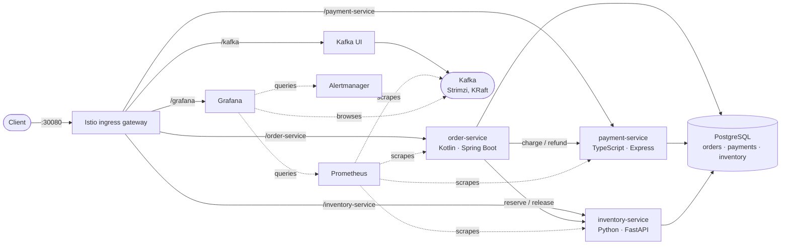
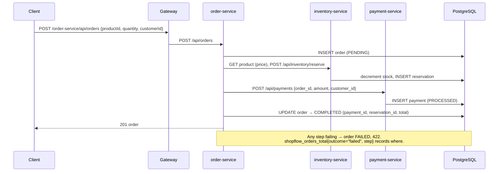
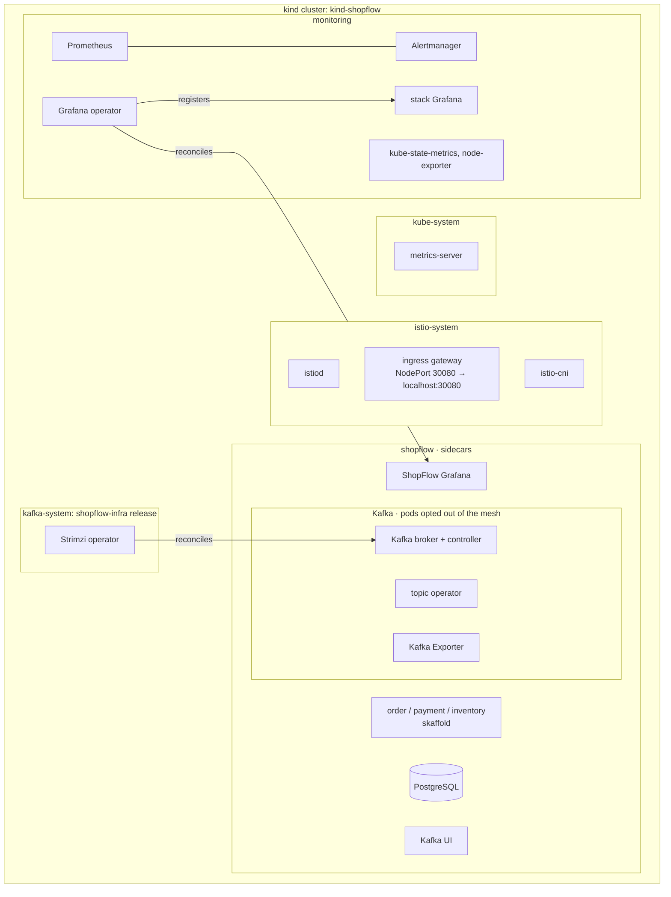

# Architecture

## Overview

ShopFlow processes B2B orders: it keeps a product catalogue with stock levels, takes orders
that reserve stock and charge the customer, and cancels completed orders with a refund and a
stock release. This repository holds the three services, their packaging (Dockerfiles, Helm
charts), the local platform they run on (kind + Istio + one infrastructure umbrella chart),
the GitOps definition for the `dev` and `prod` clusters, and the CI/CD that builds, tests,
publishes and promotes them.

In scope: everything needed to run and ship the services. Out of scope: provisioning the
`dev`/`prod` clusters and ArgoCD itself (the ApplicationSet assumes both exist).

## Components



**order-service**: orchestrates an order: reserves stock in inventory-service, charges the
customer through payment-service, and records the outcome (`COMPLETED` / `FAILED`) in the
`orders` database. Cancelling a `COMPLETED` order refunds the payment, releases the
reservation and marks it `CANCELLED`.

**payment-service**: records payments (`PROCESSED`) and refunds (`REFUNDED`) in the
`payments` database, and summarises them per customer.

**inventory-service**: owns the product catalogue and stock in the `inventory` database:
reservations decrement stock, releases put it back, restocks add to it.

**Istio ingress gateway**: single entry point. A shared `Gateway` (`shopflow/shopflow-gateway`)
and one `VirtualService` per backend route by path prefix; the service routes strip the prefix
(services serve `/health`, `/api/...`), Kafka UI and Grafana keep it (they are configured to
serve under `/kafka` and to build links under `/grafana`). Services call each other directly
over Kubernetes DNS (`http://<service>:8080`), not through the gateway.

**PostgreSQL**: one instance, one database per service, in the `shopflow` namespace.

**Kafka**: a single-node KRaft cluster (`shopflow`) reconciled by the Strimzi operator, with
topics declared as `KafkaTopic` resources and broker-side auto-creation disabled. Kafka UI
browses it. The services do not produce or consume events yet.

**Observability**: kube-prometheus-stack (Prometheus Operator, Prometheus, Alertmanager), a
Grafana operator, and a ShopFlow Grafana instance; see [Observability](#observability).

## Data flow

Placing an order (the checkout path):



Cancelling (`POST /api/orders/{id}/cancel`, only for `COMPLETED` orders): order-service calls
`POST /api/payments/{id}/refund`, then `DELETE /api/inventory/reservations/{id}`, then marks the
order `CANCELLED`. A failure part-way through leaves the order `COMPLETED` and surfaces as
`shopflow_order_cancellations_total{outcome="failed"}`. Endpoints are in [api.md](api.md).

## Environments

### Local: kind

`task deploy` builds the whole stack on a single-node kind cluster (`kind-shopflow`), in this
order: kind (`deploy/local/kind/cluster.yaml`) → Istio via istioctl, sidecar mode with the CNI
plugin (`deploy/local/istio/istio.yaml`) → the `shopflow-infra` umbrella release → the
`GrafanaDashboard` resources (`deploy/dashboards/`) → the services via skaffold.

Istio is installed before the umbrella on purpose: pods created before the sidecar injector is
running get no sidecar. Everything else is the one `shopflow-infra` release:



The umbrella (`deploy/local/charts/shopflow-infra`) bundles kube-prometheus-stack, the Grafana
operator, metrics-server and the Strimzi operator as subcharts (redirected to their namespaces
with `namespaceOverride`; Strimzi can only install into the release namespace, which is why the
release lives in `kafka-system`), plus its own templates for the namespaces, PostgreSQL, the
Kafka cluster, Kafka UI, the ShopFlow Grafana and the gateway. Kafka runs in `shopflow`, next
to the services, but its pods opt out of sidecar injection (`sidecar.istio.io/inject: "false"`)
and the Strimzi operator runs in `kafka-system`, so neither is in the mesh: Strimzi manages its
own inter-broker TLS, and sidecars race broker startup. Meshed clients reach Kafka in plaintext.

skaffold builds each Dockerfile's `develop` stage and deploys the service charts with the
`local/values.yaml` overlay (root, writable root filesystem, for file sync and hot reload).

### dev and prod: ArgoCD

`deploy/argo/applicationset.yaml` generates one Application per service × environment
(`order-service-dev` … `inventory-service-prod`), each into the `shopflow` namespace of the
cluster registered in ArgoCD under that environment's name.

```mermaid
graph LR
  main[main branch] -->|Release workflow| ghcr[(ghcr.io/pampatzoglou/shopflow/&lt;svc&gt;<br/>:main · :sha-&lt;commit&gt;)]
  main -->|chart at main| dev[dev cluster]
  ghcr -->|:main, pull Always| dev
  main -->|Release workflow| pr[promote/prod PR<br/>chart commit + digests]
  pr -->|merge| appset[ApplicationSet prod element]
  appset -->|chart at pinned commit| prod[prod cluster]
  ghcr -->|image@sha256 digest| prod
```

| | dev | prod |
|---|---|---|
| Chart | `main` | pinned commit (`revision` in the prod element) |
| Image | `<svc>:main`, `pullPolicy: Always` | `<svc>@sha256:…` from the prod element's `digests` |
| Values | `values.yaml` → `defaults/` → `dev/` | `values.yaml` → `defaults/` → `prod/` |
| Rollout | every push to `main` that rebuilds | merging the `promote/prod` PR |

Prod renders only with a digest (`image.requireDigest`), so a service is never run from a
floating tag. Automated sync does not prune or self-heal. Namespaces are created with Istio
injection and the `restricted` Pod Security Standard, which works with sidecars because the
clusters run the Istio CNI plugin.

## CI/CD

All workflow logic is Taskfile tasks; jobs install tools with `.github/actions/setup-tools`.

| Workflow | Trigger | Does |
|---|---|---|
| `default.yaml` | push, any branch | `task lint` → `task build:<svc>` (production stage, one job per service) |
| | pull request → `main` | `task deploy` + `task test` on a kind cluster in the runner |
| `release.yaml` | push to `main` (services, charts) / dispatch | detect changed services → `task publish:<svc>` to ghcr → `task promote:prod` → open/refresh the `promote/prod` PR |
| `devbox-update.yaml` | weekly / dispatch | `devbox update` → PR with the new `devbox.lock` |

Dependabot covers the services' dependencies, Dockerfile base images, chart dependencies,
pre-commit hooks and the actions.

## Observability

**Metrics.** Each service exposes Prometheus metrics on port 9090, separate from the API port
so `/metrics` is never reachable through the Service or the gateway. Istio metrics merging
serves the app's metrics and Envoy's on the sidecar (`:15020/stats/prometheus`), scraped by a
single mesh-wide `envoy-stats` PodMonitor; that also works under strict mTLS. Kafka (no sidecar,
so outside the mesh) is scraped directly: broker metrics from Strimzi's metrics reporter, topic and
consumer-group lag from the Kafka Exporter.

| Source | Metrics |
|---|---|
| Istio sidecars | `istio_requests_total`, `istio_request_duration_milliseconds` (RED, per workload) |
| Services | HTTP histograms; DB pool (`shopflow_db_pool_*`, HikariCP for order-service) |
| Business | `shopflow_orders_total{outcome,step}`, `shopflow_order_cancellations_total{outcome}`, `shopflow_payments_total{operation,outcome}`, `shopflow_inventory_reservations_total{outcome}`, `shopflow_inventory_releases_total{outcome}` |
| Kafka | `kafka_server_*`, `kafka_controller_*`, `kafka_consumergroup_lag` |

**Alerts.** Each service chart ships a `PrometheusRule` (thresholds in `metrics.prometheusRule`
values): high 5xx ratio, p99 latency, upstream errors, no available replicas, memory near the
limit, DB pool exhaustion, plus runtime and business rules per service: JVM heap and order
failure rate (order), event-loop lag and payment error rate (payment), insufficient-stock
rate (inventory).

**Dashboards.** The ShopFlow Grafana (`/grafana`) has Prometheus, Alertmanager and Kafka
datasources and three dashboards, declared as `GrafanaDashboard` resources in
`deploy/dashboards/`: Business overview, Service health (per service), Kafka. The operator
re-applies datasources and dashboards every minute; Grafana's own database is ephemeral.

## Configuration

Service charts layer `values.yaml` (base, renders on a bare cluster) → `defaults/values.yaml`
(true for every cluster: hardening, sizing, metrics, gateway route) → `<env>/values.yaml`.
Runtime environment variables:

| Variable | Service(s) | Purpose |
|---|---|---|
| `DB_HOST`, `DB_PORT`, `DB_NAME` | all | PostgreSQL connection (`database.*` values) |
| `DB_USER`, `DB_PASSWORD` | all | from the `<release>-db` Secret, also mounted at `/var/run/secrets/db` |
| `INVENTORY_SERVICE_URL`, `PAYMENT_SERVICE_URL` | order | peer URLs |
| `ORDER_SERVICE_URL`, `INVENTORY_SERVICE_URL` | payment | peer URLs (connectivity check) |
| `ORDER_SERVICE_URL`, `PAYMENT_SERVICE_URL` | inventory | peer URLs (connectivity check) |
| `SERVER_PORT` / `PORT` / `UVICORN_PORT` | order / payment / inventory | API port (8080) |
| `METRICS_PORT` | all | metrics port (9090) |
| `JAVA_TOOL_OPTIONS` | order | JVM heap sized from the container limit |

## Security

- **Containers**: production images are distroless (order, payment) or slim (inventory), run as
  UID 65532 with a read-only root filesystem, all capabilities dropped and no privilege
  escalation; base images are pinned by digest. Kafka UI and PostgreSQL run non-root with a
  read-only root filesystem too.
- **Network policies**: each service chart ships a NetworkPolicy (on in `defaults/`) that
  drops everything except ingress from the gateway, its peer services and Prometheus (sidecar
  metrics on :15020), and egress to DNS, istiod (:15012), PostgreSQL and the peers it calls.
  Strimzi adds its own policies for the Kafka pods.
- **Authorization (Istio)**: `shopflow` is default-deny (an allow-nothing AuthorizationPolicy
  from `shopflow-infra`). Each service chart allows the ingress gateway everything and its
  peers only the calls they make, by mTLS identity, method and path: payment-service and
  inventory-service may call order-service's `/health` only; order-service may charge, read
  and refund payments and look up, reserve and release stock. PostgreSQL accepts the three
  services on 5432, Kafka UI only the gateway, Grafana the gateway and the Grafana operator
  (which joins the mesh through a pod-level injection label for this).
- **Mesh**: Istio sidecars on everything in `shopflow` except the Kafka pods, which opt out;
  peer authentication at Istio's default (permissive). The Grafana operator (no sidecar) talks
  to Grafana in plaintext, and clients reach Kafka in plaintext.
- **Secrets**: database credentials reach pods only through a Secret (env `secretKeyRef` and
  file mount); the charts also support an existing Secret or Vault dynamic credentials. The
  local and base values carry the static `postgres`/`postgres` login.
- **Local only**: both Grafanas allow anonymous Admin access (the operator still authenticates
  with the generated admin Secret). Cluster tasks refuse any kube context other than the local
  kind one (`kind-<cluster>` with an API server on localhost).
- **Supply chain**: every GitHub Action is pinned to a commit SHA; prod runs images by digest;
  gitleaks runs as a pre-commit hook.

## Toolchain

`devbox.json` / `devbox.lock` define the toolchain. CI (`.github/actions/setup-tools`) and the
devcontainer install the exact versions `devbox.lock` resolves. The devcontainer is the
prebuilt image `ghcr.io/pampatzoglou/devcontainer`, pinned by digest, plus features for JDK,
Node and kubescape. `task ci:versions` (part of `task lint`) fails on any drift, and on a devbox
package missing from the devcontainer. It reads the image's versions from its Dockerfile at the
commit in the image tag.
